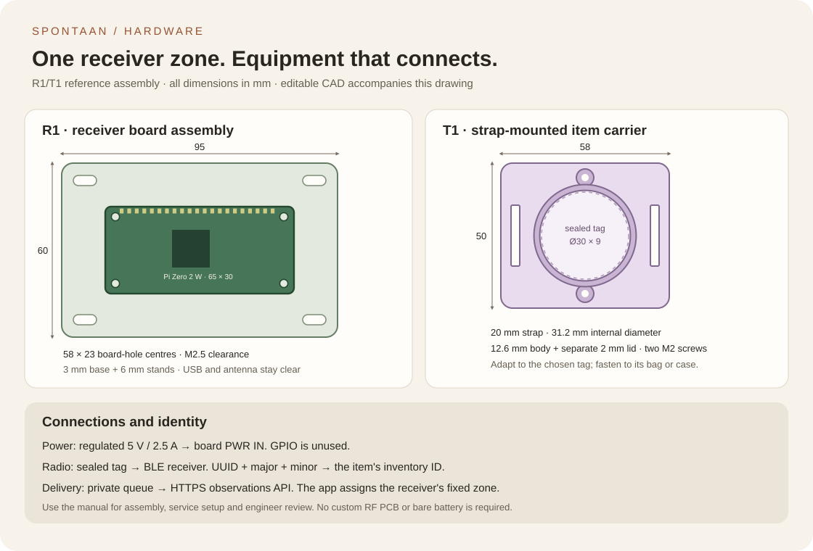

# Spontaan · equipment installation manual

Revision R1/T1 · 23 October 2026. This is the hardware handoff for the working
Spontaan application and its fictional Commons setting. Location means **last
heard in a receiver's configured zone**, with a timestamp. A receiver's RSSI is
not converted into coordinates or a claimed distance.

## What is designed



| Part | Design and supplied files | Build decision |
| --- | --- | --- |
| R1 receiver board | Raspberry Pi Zero 2 W reference assembly, power/network map, a 95 × 60 mm carrier and printable CAD | Use the existing BLE/Wi-Fi board; no custom RF PCB is needed for this assembly. The engineer can substitute another Linux receiver. |
| T1 item | Carrier for an already sealed 30 × 9 mm tag; 20 mm strap slots; separate lid; editable CAD | Measure the selected tag, edit its diameter/height, then check a dummy fit. The default is a design dimension, not a selected beacon model. |
| Identification | iBeacon UUID + major + minor mapped to the inventory's beacon ID | Select tags exposing those fields, or implement a different decoder against the same report contract. MAC addresses and device names are not inventory IDs. |
| Software | `fu/priv/ble_scanner.py`, configuration example, replay advertisement and service template | Radio operation uses optional Bleak 3.0.2. Replay and delivery use the same decoder, report format and private SQLite outbox. |
| Android alternative | Same inventory IDs, UTC times, credential and zone contract | A stationary Android collector can replace R1. It requires a native scanner/queue; this Python service is for Linux. A moving phone needs an explicit zone assignment design. |

R1/T1 are buildable reference designs for engineer review, with editable CAD.
Carrier fit, chosen fasteners, attachment retention, power behaviour and radio
coverage are installation work. These files are not custom PCB Gerbers or an
assertion that a fabricated enclosure has already been inspected.

## Parts and board connections

| Item | Quantity | Specification / connection |
| --- | --- | --- |
| U1 receiver board | 1 per fixed zone | Raspberry Pi Zero 2 W reference: 65 × 30 mm, BLE and 2.4 GHz Wi-Fi. Select a supported 64-bit Linux image with Python and BlueZ. |
| Power | 1 | Regulated 5 V supply rated 2.5 A and suitable micro-USB cable, connected to **PWR IN**. No battery charger or exposed mains circuit is designed here. |
| Storage | 1 | Appropriate microSD, with space for OS and the bounded outbox; owner manages updates and replacement. |
| R1 carrier | 1 | PETG or suitable enclosure material; 3 mm base, 6 mm stands, M2.5 clearance holes on 58 × 23 mm centres. Pick screw length with the actual board, washers and underside nuts. |
| Tag | 1 per tracked item | Enclosed, configurable iBeacon tag with unique UUID/major/minor and an accessible battery procedure. No receiver credential goes into the tag or its public label. |
| T1 carrier | 1 per tag where useful | Body, lid, two M2 fasteners/nuts and a 20 mm strap. Nominal M2 × 18 works with default geometry; confirm engagement and that no screw touches the tag. |

Power goes to U1 PWR IN; BLE enters U1's onboard antenna; Wi-Fi carries HTTPS
to the app. The microSD holds the OS and delivery queue. **GPIO is unused** in
R1. Keep ports accessible and leave the antenna side clear of metal or a
conductive cover. The optional carrier never changes the board's electrical
connections. Prefer an enclosed mounting position away from impact and water.

Official board reference: [product brief](https://datasheets.raspberrypi.com/rpizero2/raspberry-pi-zero-2-w-product-brief.pdf)
and [mechanical drawing](https://datasheets.raspberrypi.com/rpizero2/raspberry-pi-zero-2-w-mechanical-drawing.pdf).

## Assemble

1. Choose one receiver location and give its zone a concrete name, such as
   `Equipment wall · Court A`. A zone is operationally named; it is not an
   automatically measured polygon.
2. Print or machine the R1 carrier. Mount the board on insulating stands using
   the four existing board holes. Preserve USB, microSD and antenna clearance.
3. Install the OS, network and time synchronization. Inspect the actual BLE
   adapter and BlueZ service. Run the scanner under its dedicated service user
   with the host's required Bluetooth/D-Bus permissions.
4. Read each tag's UUID, major and minor using its configuration tool. Give every
   installed item a unique combination and record it beside its inventory ID.
5. In Spontaan **Equipment**, create the item and set that inventory beacon ID.
   Use the receiver owner's account for the items this receiver will report.
6. Create a receiver in the same account and set its fixed zone. Save the
   one-time receiver credential privately. It belongs to the receiver, not the
   item, printed label or a browser URL.
7. Copy `beacons.example.json` to the receiver and replace the example mapping.
   At most 30 items are configured per process, with one report per item every
   30–120 seconds. More capacity needs its own receiver plan and rate budget.
8. Make the private outbox directory and install the optional scanner dependency
   into a virtual environment. Copy both Python files so the scanner can import
   `equipment_collector` from its directory.
9. Run the replay command below. Then run the radio command with the same
   configuration, endpoint and outbox. The software substitution is the source
   of advertisements; the rest of the path is identical.
10. Put the already sealed tag in T1, fasten the lid and strap it to an equipment
    bag, instrument case or storage box. Keep it clear of playing surfaces,
    moving mechanisms and contact points. Measure retention on the intended
    item; loose equipment attachments are not suitable for play.
11. Confirm the intended item updates in **Equipment**, then reserve it for an
    event and inspect it through the event assistant. Revoke an installation's
    credential from the app when retiring its receiver.

## Run the software

From the repository root, decode the included advertisement without a radio,
credentials, external delivery or optional packages:

```sh
python3 fu/priv/ble_scanner.py \
  --config hardware/beacons.example.json \
  --endpoint http://localhost:4000/api/equipment/observations \
  --rehearsal --replay hardware/advertisements.example.jsonl --dry-run
```

For delivery, supply `FU_EQUIPMENT_TOKEN` through a private environment file or
the service manager. Substitute the actual HTTPS hostname and private path:

```sh
python3 -m venv /opt/spontaan/venv
/opt/spontaan/venv/bin/pip install -r fu/priv/scanner-requirements.txt

/opt/spontaan/venv/bin/python fu/priv/ble_scanner.py \
  --config /etc/spontaan/beacons.json \
  --endpoint https://APP_HOST/api/equipment/observations \
  --outbox /var/lib/spontaan-receiver/outbox.sqlite3
```

To send replay through the real API first, add
`--replay hardware/advertisements.example.jsonl` to that delivery command.
The mapping must match an item owned by the receiver's account. Replay creates
a fresh synthetic report; it is not a recorded physical sighting. Loopback HTTP
is available only with the explicit `--rehearsal` option.

Copy and edit `spontaan-receiver.service.example` after creating its dedicated
user, installing the source under `/opt/spontaan`, granting Bluetooth access
and creating `/etc/spontaan/receiver.env` with `FU_EQUIPMENT_TOKEN=...` readable
only by the system service manager. Change `APP_HOST`; preserve the private
state directory. Start it only after the foreground command works as that user.

## Queue, faults and recovery

Each accepted advertisement is mapped locally and committed before its debounce
timer advances. SQLite is bound to one exact endpoint/credential fingerprint.
HTTP runs separately from the radio callback; successful receipts delete only
the matching report. Restart drains pending reports before scanning resumes.
The receiver stops on delivery failure, invalid queue state or a full queue.
Its pending IDs/timestamps survive; radio observations made while stopped are
not reconstructed. At most 1,000 reports wait, and server age limits still apply.

| Symptom | Action |
| --- | --- |
| No item updates | Check tag power/payload, mapping, Bluetooth permissions and receiver owner. Seeing a device name is insufficient. |
| Stale item | Inspect last report time, receiver uptime/network and tag battery. No new report means unknown current presence, not a measured departure. |
| 401 / revoked receiver | Stop the service, issue a new app credential and use a new private outbox. Review the old queue; do not relabel it with the new credential. |
| 422 / expired report / bad clock | Correct time and inspect retained reports. Do not turn old sightings into new ones by changing their timestamps. |
| 429 / too many reports | Review mapping and report interval; the app caps accepted observations per receiver. Preserve pending input rather than loop aggressively. |
| Lost receipt / network outage | Restart with the same outbox and credential. Retries reuse the exact report, so one accepted observation remains one record. |

## Engineer handoff

The decision is the actual tag/receiver combination and installation design.
Confirm advertisement format, enclosure measurements, power, antenna placement,
delivery and support ownership. Keep Android as an alternative if its lifecycle,
permissions, energy and management costs fit better. Current Android guidance:
[background BLE](https://developer.android.com/develop/connectivity/bluetooth/ble/background)
and [permissions](https://developer.android.com/develop/connectivity/bluetooth/bt-permissions).

Before enabling a location for everyday use, walk the chosen items through the
intended area and adjacent areas, check typical report delay and missed reports,
and exercise power/network recovery. Use the actual space and agreed tolerances;
no university, city or venue is preselected. A copied static beacon identity can
be replayed, so this design supplies equipment convenience rather than proof
for attendance, payments or theft recovery.

## Editable item and board designs

```sh
openscad -o receiver-base.stl hardware/cad/receiver_base.scad
openscad -D 'part="body"' -o item-body.stl hardware/cad/item_carrier.scad
openscad -D 'part="lid"' -o item-lid.stl hardware/cad/item_carrier.scad
```

The mounting and item dimensions are in the CAD source. Print a dummy fit before
putting the electronics in; select material, fasteners and retention with the
engineer. No water/impact rating is assigned to these reference parts.

Scanner reference: [Bleak scanner API](https://bleak.readthedocs.io/en/latest/api/scanner.html)
and [Linux backend](https://bleak.readthedocs.io/en/latest/backends/linux.html).
